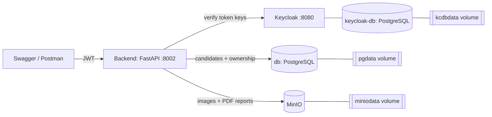

# Document Verification API (Week 6 capstone)

An admin uploads a candidate's degree certificate and marksheet. The candidate logs in and requests a report. The API reads both images with OCR, compares the name and register number, and returns a PDF saying **FIELDS MATCH**, **MISMATCH FOUND** or **UNABLE TO VERIFY**. The whole system starts with one command: `docker compose up`.

## Architecture



| Service | Image | Port | Purpose |
|---|---|---|---|
| backend | built from `Dockerfile` | 8002 -> 8000 | FastAPI app, OCR, PDF report |
| db | postgres:16 | none (internal) | candidate records and ownership |
| keycloak-db | postgres:16 | none (internal) | Keycloak's own database: realm, users, roles |
| keycloak | keycloak 26.8.0 | 8080 | login, roles, JWT tokens |
| minio | MinIO | 9001 (console) | uploaded documents and reports |

Services reach each other by service name on the Compose network (`db`, `keycloak-db`, `minio`, `keycloak`). The two databases publish no port.

## Code structure

```
app/
  main.py                 creates the FastAPI app and plugs in the routes
  core/
    config.py             all settings, read from environment variables
    security.py           Keycloak token check and the admin / user role rules
  db/
    connection.py         opens a PostgreSQL connection
    ownership.py          which Keycloak user owns which candidate id
    candidates.py         SQL for the candidates CRUD
  schemas/
    candidate.py          Pydantic models: validation of request and response bodies
  services/
    storage.py            MinIO upload, download, find, delete
    validation.py         candidate id and image checks
    ocr.py                image cleaning and text extraction (Tesseract)
    verification.py       compares the two documents
    pdf_report.py         builds the 3-page PDF
  routes/
    home.py               GET /
    candidates.py         CRUD endpoints (admin)
    report0.py            POST /report-0 (admin uploads documents)
    final.py              POST /report-final (candidate gets the report)
```

Each folder has one job: `core` (settings and security), `db` (database code), `schemas` (data shapes), `services` (the work), `routes` (HTTP endpoints).

## Run it (from a fresh clone)

Requires Docker Desktop.

```bash
git clone <your-repo-url>
cd <repo>/week6
cp .env.example .env        # Windows: copy .env.example .env
```

Fill the values in `.env` (these local demo values work):

```
DB_USER=capstoneuser
DB_PASSWORD=CapstoneDb2026
DB_NAME=capstone_db
KC_DB_USER=keycloak
KC_DB_PASSWORD=KeycloakDb2026
KC_DB_NAME=keycloak
MINIO_ACCESS_KEY=minioadmin
MINIO_SECRET_KEY=MinioSecret2026
KC_ADMIN=admin
KC_ADMIN_PASSWORD=KcAdmin2026
KC_REALM=capstone
```

Avoid `@`, `:` and `/` in `DB_PASSWORD` (it is placed inside a URL). Then:

```bash
docker compose up -d --build
docker compose ps           # wait about 60 s for Keycloak
```

Open Swagger at **http://localhost:8002/docs**.

The Keycloak realm `capstone`, the roles `admin` and `user`, the client `capstone-client` and two test users are created automatically on the first start, from `keycloak/capstone-realm.json`:

| User | Password | Role |
|---|---|---|
| admin1 | Admin@12345 | admin |
| candidate1 | Candidate@12345 | user |

Keycloak admin console: http://localhost:8080 (`KC_ADMIN` / `KC_ADMIN_PASSWORD`).

## Keycloak keeps its data

Keycloak stores its realm, users, roles and any changes you make in its own PostgreSQL database (`keycloak-db`), on the named volume `kcdbdata`. The realm file is imported only if the realm does not exist yet, so a restart never overwrites changes. A user you create in the Keycloak console is still there after `docker compose down` and `docker compose up -d`.

## Get a token (PowerShell or Command Prompt)

```powershell
powershell -ExecutionPolicy Bypass -File .\get-token.ps1                                            # admin
powershell -ExecutionPolicy Bypass -File .\get-token.ps1 -User candidate1 -Pass 'Candidate@12345'  # candidate
powershell -ExecutionPolicy Bypass -File .\show-candidate-id.ps1                                    # candidate's user id
```

In Swagger click **Authorize** and paste the token without the word `Bearer`. Tokens last about 5 minutes. Paste a token at jwt.io to see the role under `realm_access.roles`.

## Endpoints

| Method | Path | Who | Success | Errors |
|---|---|---|---|---|
| GET | `/` | anyone | 200 | |
| POST | `/candidates` | admin | 201 | 401, 403, 409 duplicate, 422 bad body, 400 bad id |
| GET | `/candidates` | admin | 200 | 401, 403 |
| GET | `/candidates/{id}` | admin | 200 | 401, 403, 404 |
| PUT | `/candidates/{id}` | admin | 200 | 401, 403, 404, 422 |
| DELETE | `/candidates/{id}` | admin | 204 | 401, 403, 404 |
| POST | `/report-0` | admin | 200 | 400, 401, 403, 409 id owned by another user, 413 file too big |
| POST | `/report-final` | candidate (role `user`) | 200 PDF | 401, 403 not your id, 404 not registered, 503 storage down |

Usage order for the report: the admin calls `/report-0` with `candidate_id`, `candidate_user_id` (the candidate's Keycloak id) and two images; then the candidate calls `/report-final` with the same `candidate_id`.

## Commands

```bash
docker compose ps                  # status
docker compose logs -f backend     # follow the API log
docker compose exec backend sh     # shell inside the API container
docker compose down                # stop, KEEP all data (named volumes)
docker compose up -d               # start again, data is still there
docker compose down -v             # stop and DELETE all data, including Keycloak's
```

## Data survives a restart

PostgreSQL (`pgdata`), Keycloak's database (`kcdbdata`) and MinIO (`miniodata`) each use a named volume. After `docker compose down` and `docker compose up -d`, the candidates, uploaded documents and Keycloak users are still there.

## Configuration

Every value comes from `.env` through `${VAR}` in `docker-compose.yml`. The real `.env` is git-ignored; `.env.example` is committed. The backend reads `DATABASE_URL`, `MINIO_*` and `KEYCLOAK_JWKS_URL` from the environment.
